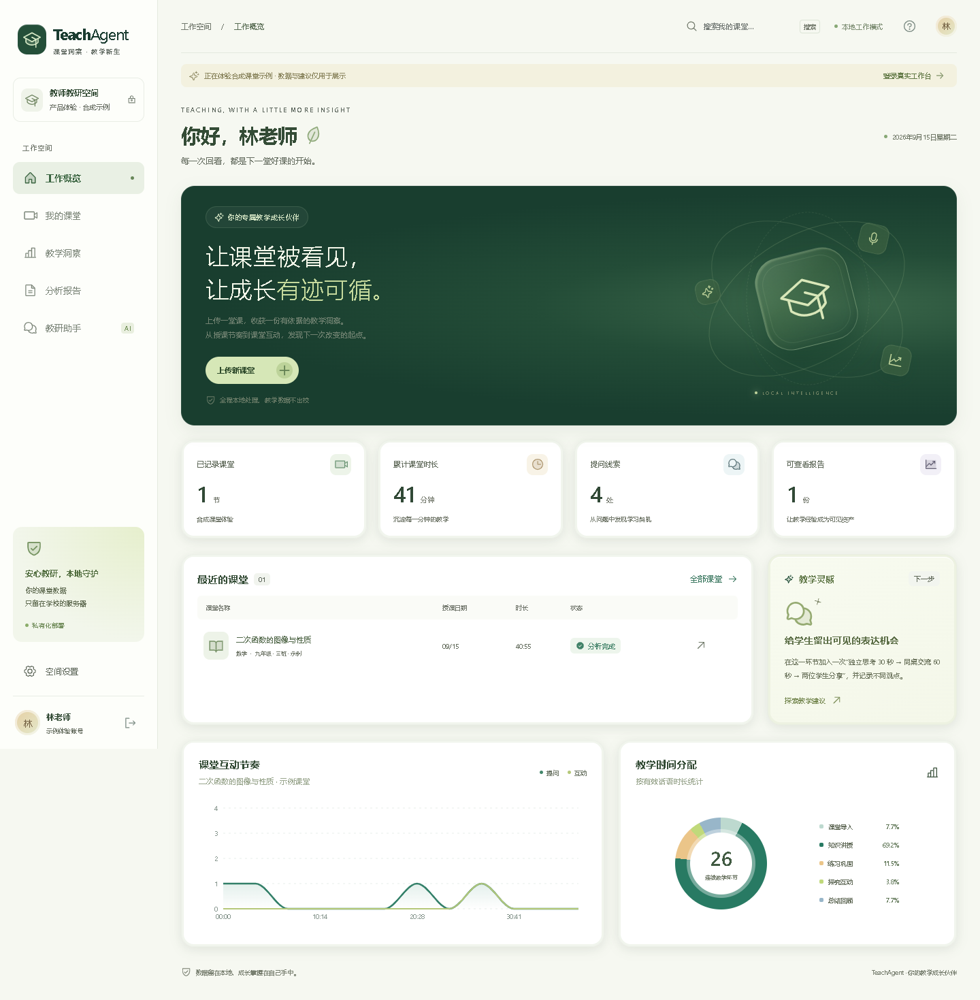
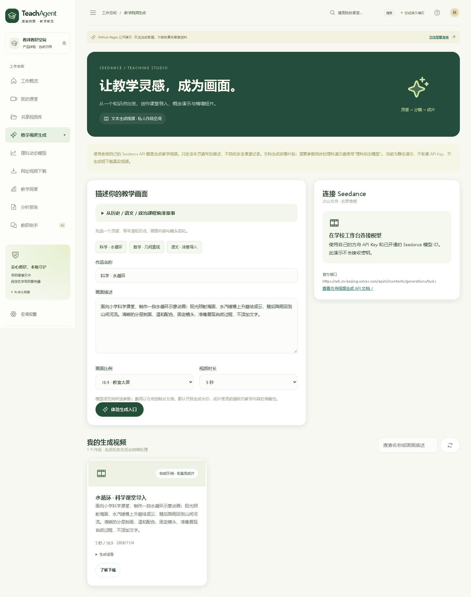

# TeachAgent

**当前版本：1.6.0 — 视频网址下载、理科动态模型、文科故事与个人算力。**

### 让课堂被看见，让成长有迹可循。

面向学校内网的课堂分析与教研 Agent 工作台。默认课堂分析在学校本地处理与保存；可按教师账号启用 OpenAI 兼容在线模型进行教研追问。启用并确认后，追问的课堂文本上下文发送至所配置的服务。另可在每次上传时授权科大讯飞云端语音听写，此时音轨发送到讯飞。1.5.0 支持按次确认后将手动填写的提示词发送至 Seedance 生成教学短片；不自动发送课堂视频或分析记录，成片下载到本地管理。界面无埋点、外部字体或 CDN。



## 在线演示与自动部署

[体验 GitHub Pages 工作台](https://mm477706421.github.io/TeachAgent/)

Pages 只提供合成课堂演示，直接进入工作台，不显示教师登录表单、不读取真实视频、不调用后端 API。可下载合成 Word 报告、预览模型预设与模拟对话；真实使用请部署本地服务。

推送到 `main` 后，GitHub Actions 依次执行后端与本地版浏览器测试、Pages 构建、静态演示浏览器测试，全部通过后发布 Pages，并通过专用 SSH 密钥自动部署到 [正式服务器 8080 端口](http://43.165.169.59:8080/)。部署前备份数据库，健康检查失败时恢复旧版本。也可在 Actions 手动运行工作流。Pages 使用内置 `GITHUB_TOKEN` 和 OIDC；服务器 SSH 凭据保存在 GitHub Secrets，不写入源码。

Pages 构建命令为 `npm run build:pages`，仓库路径为 `/TeachAgent/`，输出目录 `frontend/dist-pages/`；本地版仍使用 `npm run build` 和 `frontend/dist/`。仅静态演示产物会上传到 Pages，数据目录、模型、密码和本机配置不会上传。

## 可选讯飞语音转写

1.3.0 支持讯飞流式语音听写。管理员在私有环境变量配置 `IFLYTEK_APP_ID`、`IFLYTEK_API_KEY`、`IFLYTEK_API_SECRET`，教师上传时选择讯飞并确认音频外发；默认仍使用本地 Whisper。支持长视频分块顺序转写、动态纠错合并、明确来源与分块时间标记。

参见[讯飞配置与使用说明](docs/讯飞语音转写使用说明.md)及[Word 图文使用说明书](docs/TeachAgent-图文使用说明书.docx)。云端模式有外发与计费，8 秒分块并非逐句时间戳。

## 共享视频库

1.4.0 新增学校共享视频库：教师单独确认后上传视频，同校已登录教师可搜索、预览、下载；上传者和管理员可删除。私人课堂保持隔离，资源上传不自动触发转写或 AI。按账号备份包含本人共享资源。详见[共享视频库使用说明](docs/共享视频库使用说明.md)。

## Seedance 教学视频生成（1.5.0）



1. 登录正式服务，进入左侧 **教学视频生成**。
2. 在“连接 Seedance”填写火山方舟北京地域的 **API Key** 和已开通的 **Seedance 模型 ID / 推理接入点 ID**，点击保存。密钥按账号加密、不回显；留空保留，勾选可清除。
3. 选择科学、数学或语文模板，填写作品名称与画面描述，选择 5 / 10 秒和 16:9 / 9:16 / 1:1 比例。模型必须支持所选参数。
4. 确认提示词外发与可能产生的费用，提交任务。后台持续查询进度，即使关闭页面也会继续处理。
5. 完成后在“我的生成视频”预览、下载 MP4、搜索、重命名或删除；下载失败可重试下载，不会重新生成。删除本地作品不会退款或删除供应商留存的任务。

接口使用官方 `https://ark.cn-beijing.volces.com/api/v3/contents/generations/tasks`，不是 OpenAI Chat Completions 接口。目前支持文本生成视频；不包含图生视频、参考图、配音编辑或第三方转接网关。默认带生成水印；教师应审核教学事实与画面准确性后使用。

成片与记录按教师隔离，管理员按账号备份包含成片与元信息，不包含 API Key。每个账号最多 3 个活跃任务；单个下载上限 512 MiB。GitHub Pages 仅展示交互与合成卡片，不接收密钥、不调用生成服务。

详见 [Seedance 配置、使用与故障处理](docs/Seedance教学视频使用说明.md)。自动测试使用模拟供应商响应与合成视频，不消耗真实额度；真实模型可用性、计费与出片质量需使用自己的已授权 Key 验证。

## 已实现

### 1.6 新增：按教学场景制作素材

- **网址视频下载**：粘贴公开 MP4 / WebM 链接，或含直接视频地址的静态页面，后台下载完成后点击“下载到电脑”。下载仅本人可见，支持预览和删除；限 1 GiB / 6 小时，不支持需登录的网盘、动态播放器或 DRM 视频。内网资源可继续使用共享视频库上传。
- **理科动态模型**：输入课程内容或原理，生成受支持的公式模型；首批包含单摆、平抛、弹簧振子、正弦行波和 RC 充电。播放、暂停、时间轴、倍速与初始条件均可调整，画面和旁边的参数严格取自同一物理时刻。可保存账号课件并导出离线可动 HTML。
- **文科故事片段**：在“教学视频生成”中展开历史 / 语文 / 政治故事编排，输入课程依据，生成可编辑的镜头提示词，再提交视频生成。教师应核对史实、引文与内容准确性。
- **老师选择算力**：视频可选个人 Seedance API 额度，或自己部署的 ComfyUI 视频工作流；两套配置独立保存。理科动画本身在浏览器本地计算，描述解析可选规则、空间设置中的个人在线模型或本地 Ollama。

本地 GPU 模式需要事先部署视频模型和能输出 MP4 的 ComfyUI API 工作流。应用负责提交、查询、下载与管理，不包含 GPU、模型权重，也不会把个人电脑上的 `localhost` 自动连接到公网服务器。详见 [客户需求与 1.6 使用指南](docs/教学素材与个人算力使用指南.md)。

- **本地视频管线**：MP4 / MOV / MKV / AVI / WebM / M4V 上传，FFmpeg 抽帧与音轨提取，faster-whisper 离线转写，任务进度、失败原因与重试。
- **文本蒸馏与画像**：TXT / SRT / VTT 导入，文本清洗，环节时间轴、提问和互动线索、话语语速、语言习惯及证据化改进建议。
- **可配置教研助手**：本机 Ollama / 本地规则 / OpenAI 兼容服务；独立账号配置、流式连接测试、密钥本地加密、基于课堂证据连续追问；真正流式输出、停止生成、重试与重新生成。在线失败明确报错，本机 Ollama 不可用时明确退回规则建议。
- **云端模型预设**：11 个可搜索的服务商项目，选中后只需填写 Key；地址与模型自动配置，按账号分别加密保存各服务的 Key。保留 HTTP / HTTPS 自定义端点。
- **清晰的对话阅读**：随真实模型流实时显示；Markdown 标题、列表、引用、代码块与表格正确排版，历史回答直接完整展示。
- **教师独立空间**：账号登录、会话校验、课堂数据隔离、视频回看、原文定位、Word / JSON / HTML 报告导出，旧 Markdown API 保留兼容。
- **学校管理**：`admin` 为超级管理员，可新建管理员与教师；普通管理员可创建教师、按权限导出 ZIP 备份。支持审计日志、密码修改与本地密码重置。
- **Seedance 教学短片**：账号级密钥、提示词模板、异步任务进度、本地成片下载、作品管理、失败恢复与明确的外发计费确认。
- **响应式 WebUI**：宽屏可折叠侧栏、平板图标栏、手机抽屉导航；侧栏独立滚动，搜索、图表、表格、表单和课堂详情覆盖 320px 至 1920px。墨绿暖白风格与合成示例保留。

> 一期分析以语音和文本为主。环节与互动由可审计规则识别，不输出伪造的教学评分或师生占比。动作、板书、声纹分离与深度视觉分析属于扩展能力。

## 快速运行

环境：Python 3.12、Node.js 22+、FFmpeg（含 ffprobe）。首次安装依赖需要联网；本地模式正式运行可完全断网，在线模型追问需要访问配置的服务。

```powershell
python -m venv .venv
.venv/Scripts/python -m pip install -r requirements.txt
cd frontend
npm ci
npm run build
cd ..
.venv/Scripts/python -m backend.cli create-admin
.venv/Scripts/python -m uvicorn backend.main:app --host 127.0.0.1 --port 8000 --workers 1
```

管理员命令会生成随机密码，请保存该本地终端输出。访问 **http://127.0.0.1:8000**，登录后即可导入文本分析；也可以在登录页体验只读合成示例。

Linux 将 `.venv/Scripts/python` 换为 `.venv/bin/python`。生产运行必须使用 **1 个 Uvicorn worker、1 个应用实例**；ASR 队列按顺序执行。

### 准备本地模型

1. 在独立联网准备环境下载完整的 `Systran/faster-whisper-small` 模型目录。
2. 搬运到 `models/whisper-small/`，至少包含 `model.bin`、`config.json`、`tokenizer.json`、词表等模型原始文件。
3. 将 `.env.example` 复制为 `.env`，设置模型和 FFmpeg 路径。
4. 在“空间设置”检查就绪状态，然后上传有音轨的课堂视频。

运行时强制 `HF_HUB_OFFLINE=1`、`TRANSFORMERS_OFFLINE=1` 和 `local_files_only=True`，不会自动下载模型。模型不随源码或 Release 分发。

### 可选：本机 Ollama

在联网准备阶段预装 Ollama 并执行 `ollama pull qwen2.5:7b`，随后断网运行。默认地址为 `http://127.0.0.1:11434`。只接受本机回环 IP，禁止外部 URL、代理继承与重定向。没有 Ollama 也能转写、分析和导出，追问会显示“本地规则建议”。

### 可选：OpenAI 兼容在线模型

登录后进入 **空间设置 → 模型服务设置**，选择“OpenAI 兼容服务”，填写 Base URL（例如 `https://api.openai.com/v1`）、服务支持的模型 ID、API Key，确认文本发送范围，点击“测试连接”，成功后点击“保存模型设置”。测试使用当前表单，不自动保存、不发送课堂材料。Base URL 支持 HTTP 和 HTTPS（例如 `http://192.168.1.10:8000/v1`）。使用 `stream=true` 的 `/chat/completions` SSE 接口，参数包括超时、温度与输出 token 上限；服务需支持这些参数及文本增量 `choices[].delta.content`。连接测试同样验证流式协议。生成中可停止，保留已收到内容；最近一轮可重试或重新生成，替换原回答且不重复问题。切换页面会关闭上游连接。规则模式一次返回；Pages 仅模拟流式交互。

设置只作用于当前账号的教研追问，不替代本地 ASR 或基础分析。追问发送本课摘要、指标、建议、方法边界、前 100 个转写片段、最近 8 条对话及当前问题。页面展示目标服务和回答来源；认证失败、限流、超时会明确报错。

API Key 用 Fernet 加密存入本地 SQLite，解密密钥位于 `TEACHAGENT_DATA/model-settings.key`。页面不会回显密钥，也不写入浏览器本地存储。同地址留空保留密钥，支持主动清除；更改服务地址后不沿用旧密钥。按账号 ZIP 不包含模型设置或密钥；整机灾备必须包含密钥文件。公开 Pages 仅预览设置，不接收 API Key、不调用模型。

### Docker

```bash
docker compose up -d --build
docker compose exec teachagent python -m backend.cli create-admin
```

默认只向宿主回环地址发布 8000 端口。学校访问应使用内网 HTTPS 反向代理，并设置 `COOKIE_SECURE=1`。容器中的 `127.0.0.1` 指向容器本身；与宿主 Ollama 协作的 Linux host-network 配置见部署文档。

## 文档

- [详细功能与部署文档](docs/功能与部署文档.md)：全部功能、操作步骤、计算口径、架构、部署、备份恢复、API、验收与扩展。
- [Word 版功能文档](docs/TeachAgent-功能与部署文档.docx)
- [1.1 系统检验报告](docs/系统检验报告-2026-09-18.md)：本轮功能矩阵、真实离线转写与未测边界。
- [1.0 验收记录](docs/验收记录.md)：历史测试结果。
- [响应式布局验收](docs/响应式布局验收.md)：断点行为、导航交互与浏览器矩阵。
- [版本变更](CHANGELOG.md)
- [GitHub Actions 自动部署说明](docs/自动部署说明.md)：main 更新后自动验证并发布到服务器 8080 端口，含凭据、备份与故障恢复说明。

## 开发与验证

```bash
python -m pip install -r requirements-dev.txt
python -m pytest -q
cd frontend
npm run build
# 在后端已启动的条件下运行：
npm run test:e2e
```

浏览器默认使用系统 Microsoft Edge；其他环境设置 `PLAYWRIGHT_CHANNEL=chromium` 并运行 `npx playwright install chromium`。真实登录端到端检查需设置 `TEACHAGENT_E2E_USERNAME` 与 `TEACHAGENT_E2E_PASSWORD`。

本地双服务开发：后端 8000 端口，前端 `npm run dev` 启动 Vite；`/api` 自动代理到本机后端。生产部署使用 FastAPI 托管构建后的前端。

## 数据与开源范围

源码采用 MIT 许可。学校数据归学校统一管理。`.data/`、`.env`、模型、虚拟环境和个人账号信息不进入 Git。仓库内课堂内容全部为明确标注的人工合成示例。
