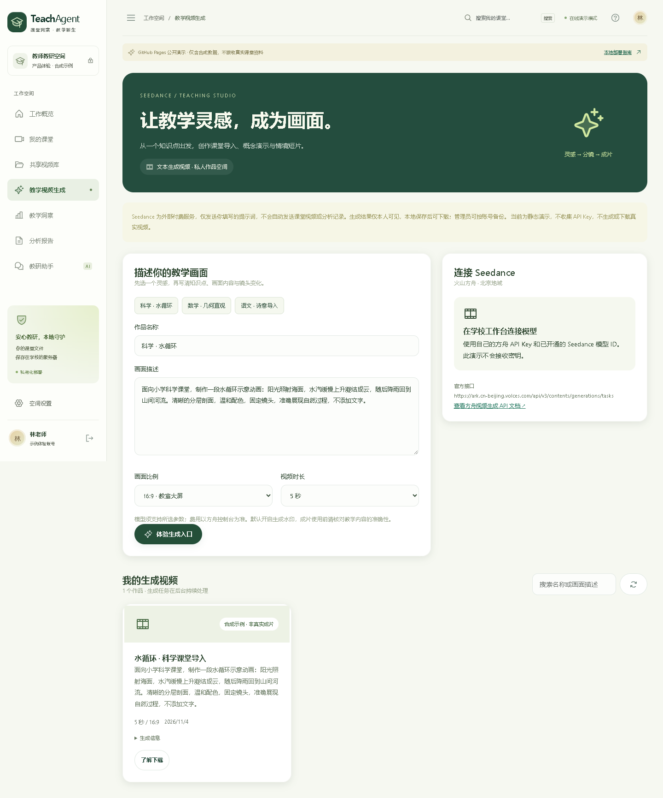

# Seedance 教学视频使用说明

TeachAgent 1.5.0 · 2026-11-04

## 准备账号与接口

在火山方舟开通可用于文生视频的 Seedance 模型，创建对应 API Key，并确认模型/推理接入点属于北京地域。模型版本和计费以方舟控制台为准，不在应用中硬编码一个可能下线的模型 ID。

- API 地址固定为 `https://ark.cn-beijing.volces.com/api/v3/contents/generations/tasks`。
- 认证为 `Authorization: Bearer <API Key>`，只在服务端调用；浏览器不会直接访问供应商或收到保存的密钥。
- [官方 API 文档](https://www.volcengine.com/docs/82379/1520757)；协议字段依据 [官方 Python SDK](https://github.com/volcengine/volcengine-python-sdk/blob/master/volcenginesdkarkruntime/resources/content_generation/tasks.py) 核对。
- 暂不支持第三方 Seedance 转接平台、海外地域、图生视频或多参考图。原有 OpenAI 兼容教研设置独立保留。

## 生成与管理

1. 登录学校工作台，打开“教学视频生成”。
2. 填写模型 ID、API Key，保存设置。密钥留空表示保留原值；勾选“清除”删除已保存配置。已提交任务使用提交时的加密凭据完成查询，不受设置切换影响。
3. 选用科学、数学或语文模板，或自己描述教学画面。建议包含年级、知识点、场景、镜头和风格，避免学生身份信息。作品名称留在本地，不作为画面描述发送。
4. 选择比例和 5 / 10 秒时长。确认外发与费用后点击生成。每次生成需重新确认；账号同时最多 3 个活跃任务。
5. 列表显示云端排队、生成、保存成片与完成等状态。服务器约每 15 秒调度查询；浏览器约每 8 秒刷新列表，供应商响应与下载期间可能更久。
6. 成功后预览或下载 MP4。可搜索作品名称和提示词、翻页、重命名、删除。删除需要二次确认；进行中的任务不允许删除。生成视频不会自动发布到学校共享库，如需共享可下载后单独上传。

视频仍需教师审核。生成模型可能出现科学错误、文字不清晰或不符合预期的画面；应用开启生成水印，不承诺供应商结果的教学准确性。费用由方舟收取，不通过本系统结算。

## 外发与存储边界

仅提交手动填写的提示词、模型 ID、比例、时长与水印参数。不会自动发送已有课堂视频、音轨、转写或报告。API Key 按教师账号加密存入本地数据库，共用本地 `model-settings.key` 加密主密钥。备份整机时需保留该密钥文件，不能只复制数据库。

成片保存在 `.data/users/<账号ID>/generated-videos/<作品ID>/video.mp4`（生产环境 DATA 为 `/var/lib/teachagent`）。本地下载限 512 MiB，使用官方媒体域名 HTTPS、禁止跳转，下载不附带 API Key，半成品不作为视频提供。成片下载完成后不再依赖临时云端链接。

账号仅能浏览、下载和管理自己的作品；管理员可按已有权限导出账号 ZIP，包含成片及不含凭据的任务元信息。活跃生成期间禁止导出，以避免不完整快照。静态 Pages 不接受任何密钥或提交请求。

## 常见状态与恢复

| 状态 | 处理方式 |
| --- | --- |
| 未配置 | 保存有效的模型 ID 和 API Key；保存仅验证格式，不会进行付费生成 |
| 生成失败 | 核对模型权限、参数、额度、内容审核和方舟任务详情；修正后再次生成属于新计费任务 |
| 下载失败 | 点击“重试下载”，查询同一个云端任务并重新获取链接，不重新生成 |
| 查询已暂停 | 检查网络/权限并保存有效 Key，再点击“重新查询原任务”；仍不会重新生成 |
| 需核对提交结果 | 提交期间超时或服务中断，可能已计费。先到方舟控制台按提交时间核对；不要直接创建重复任务。若任务已成功，可在控制台取回成片 |
| 云端过期/取消 | 本地标记失败，不会自动发起新的付费任务 |

提交 POST 不自动重试。浏览器在同一次提交的网络重试中复用请求编号，服务端返回原记录；刷新页面会产生新的提交编号，因此仍需先核对已有列表。重试下载或查询只执行 GET，不触发生成费用。

服务重启会继续查询已取得云端 ID 的任务；尚未取得云端 ID 的提交标记为“需核对提交结果”。查询遇到权限/任务不存在错误会暂停；长时间网络错误也会暂停。API Key 不可用时不会自动更换供应商或回退到伪造视频。

## 部署与验证

继续使用单个 Uvicorn worker、单实例。数据库启动时仅新增 `seedance_settings` 和 `generated_videos` 表，不修改既有课堂记录。CI/CD 发布前等待已有生成/下载任务完成，最多 10 分钟；任务较长则取消部署，待任务结束后重跑 Actions。

自动验证涵盖账号隔离、CSRF、凭据加密与脱敏、重复提交去重、状态更新、下载重试、文件范围下载、备份、媒体来源与大小限制，以及桌面/手机/Pages 交互。供应商响应使用模拟接口，视频为合成测试素材。没有真实 Seedance 凭据时，不声称已验证实际云端出片、计费或生成质量。
