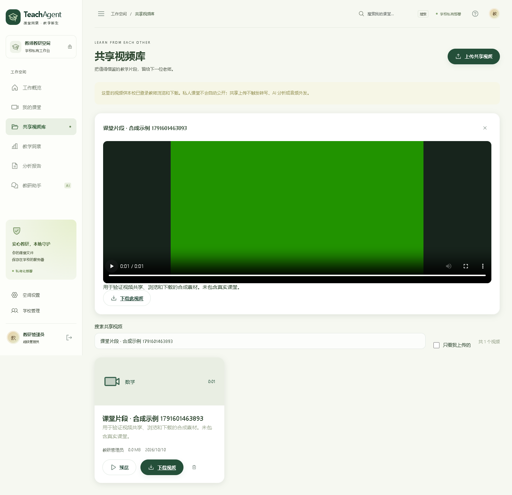

# 共享视频库使用说明（1.4.0）

这是 TeachAgent 内置的学校共享资源库。教师上传视频后，同一部署中的其他已登录教师可搜索、预览并下载。它不解析外部网盘或第三方资源库链接。

## 上传视频

1. 登录学校工作台，在左侧导航点击 **共享视频库**。
2. 点击 **上传共享视频**，填写视频名称、学科和借鉴要点，选择本地视频文件。
3. 确认有权共享，同意本校所有已登录教师浏览和下载后，点击 **确认共享上传**。
4. 等待传输和文件校验结束。成功后，视频显示在共享列表中，其他教师即可访问。

支持 MP4、MOV、MKV、AVI、WebM、M4V；最长 6 小时，大小上限与学校服务器上传配置一致，默认 2 GB。支持无音轨的教学演示视频。推荐 H.264 / AAC 编码的 MP4，以便浏览器直接播放。

上传不会自动触发转写或教学分析，不会发送到讯飞或其他 AI 服务。服务器检查文件格式、视频流和时长，无效或超限上传会失败并清理本次临时文件。

## 查找、观看和下载

- 在 **搜索共享视频** 中输入视频名称、学科或上传教师姓名；**只看我上传的** 可筛选本人资源。
- 每页展示 12 项，超过一页时使用上一页 / 下一页。
- 点击 **预览** 可在当前页面观看；**关闭视频预览** 结束预览。
- 点击 **下载视频** 或预览区的 **下载此视频**，浏览器保存原始文件。下载不要求先完成 ASR 或分析，也不会把大文件先整体缓存到前端内存。
- 浏览器不支持某些 AVI、MKV 或特殊编码时，可下载后用本地播放器观看。
- 需要分析对标视频时，下载后到 **上传新课堂** 单独导入，自行选择转写方式。

**我的课堂** 内有原视频的课堂也增加了 **下载视频** 入口，只允许课堂所属账号下载。

## 共享范围与管理

私人课堂不会自动进入共享库。共享库只展示教师通过专门入口、明确确认后上传的视频；不公开教师的私人转写、分析报告、AI 对话或模型设置。未登录访问者无法查看共享列表或下载文件。共享范围是当前 TeachAgent 部署中的全部已登录账号，适用于单校部署。

教师可以删除自己上传的共享视频，管理员可以删除任意共享视频。点击删除后需要再次确认；删除会移除共享文件和列表记录，但不能撤回其他教师已经下载的副本。

学校管理中的按账号 ZIP 备份包含该账号上传的共享视频及 `manifest.json` 中的 `shared_videos` 元信息；不重复导出其他教师的视频。上传和删除共享视频会记录到审计日志。模型密钥和会话仍不进入账号备份。

## 演示与部署

GitHub Pages 仅展示合成视频卡片，不包含真实视频、不接受上传、不调用下载接口。真实操作使用学校服务器版本。

服务升级会自动创建 `library_videos` 表及索引，既有私人课堂与账号不变。共享文件保存到 `TEACHAGENT_DATA/users/<账号ID>/shared-videos/<资源ID>/source.video`；未完成上传暂存于 `TEACHAGENT_DATA/library-uploads`。异常关机留下的临时目录由管理员在确认没有活动上传后清理。多视频仍会占用学校服务器磁盘，请结合存储容量管理资源。

新增接口：

| 方法 | 路径 | 用途 |
| --- | --- | --- |
| GET | `/api/library?q=&mine=false&offset=0` | 登录后查询共享列表 |
| POST | `/api/library/upload` | 上传、确认共享、校验视频 |
| GET | `/api/library/{id}/media` | 视频预览，支持 Range |
| GET | `/api/library/{id}/media?download=true` | 下载原文件 |
| DELETE | `/api/library/{id}` | 上传者或管理员删除 |
| GET | `/api/lessons/{id}/media?download=true` | 下载本人私人课堂原视频 |

写接口需要现有会话与 CSRF 校验。上传表单字段为 `title`、`subject`、`description`、`allow_school_share=true`、`file`。
