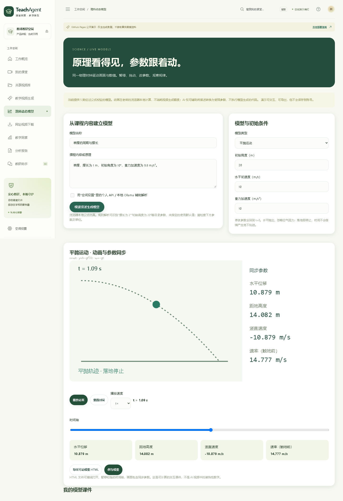
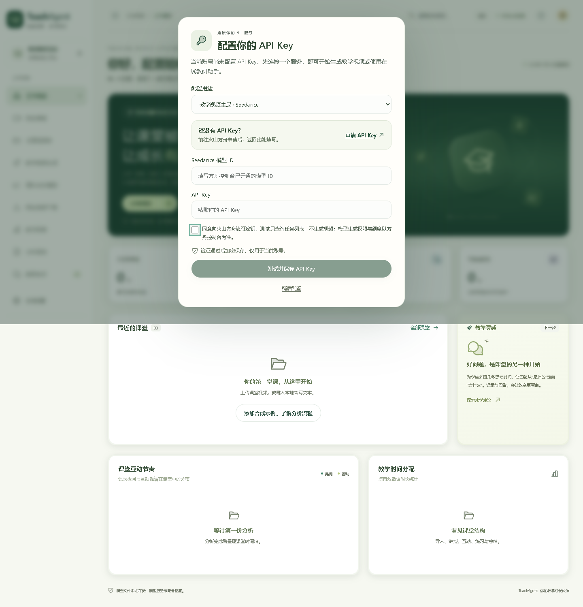

# 教学素材与个人算力使用指南

TeachAgent 1.6.3 · 2026-11-19

## 客户需求整理

教师可输入视频网址，将有权使用的视频下载并管理。系统支持依据课程内容或文字描述制作教学素材：理科以可交互、可计算的动态模型展示原理，模型运动时同步显示对应的时间、位移、速度或电学参数；文科围绕历史、语文、政治教材内容编排故事并生成视频。视频生成使用教师个人 Seedance API 额度；理科交互动画仍在浏览器本地计算。所有配置及个人作品按账号隔离，继续支持 GitHub Pages 演示与正式服务器自动部署。

## 1. 输入网址下载视频

进入“网址视频下载”，填写名称和网址，确认具有下载使用权限后提交。系统先在后台下载到私人空间，完成后可预览、下载到电脑或删除。关闭页面不影响后台任务。

支持公开 MP4 / WebM 文件地址，以及静态 HTML 中直接声明 video、source 或 og:video 的页面。最多检查六次地址跳转，每次均重新校验目标，连接到已验证的公网 IP。网站登录、网盘提取码、需要 JavaScript 解析的播放器、分片 HLS/DASH 和 DRM 视频不在本次范围内。无法取得真实视频时会显示失败，不会把网页文件当成成功的视频。

每账号最多 3 个排队 / 下载任务，服务器顺序执行；单文件上限 1 GiB、时长不超过 6 小时、网络下载最多 10 分钟。失败时请修正网址后重提。含签名的链接加密临时保存，完成 / 失败后清除；列表不回显链接。不能借此入口读取本机、内网或云元数据地址；学校内网视频可用共享视频库上传。

## 2. 理科：原理、运动与参数同步

进入“理科动态模型”，填写课程内容，点击“根据描述生成模型”。默认本地规则识别课题与明确填写的目录参数；也可启用空间设置中自己的在线模型或本地 Ollama 辅助解析。在线模型需确认发送描述。AI 只输出模型类别与参数，由服务端验证，不能注入或执行程序代码。

首批经过公式校验的模型：

| 模型 | 可调参数 | 同步显示 | 适用条件 |
| --- | --- | --- | --- |
| 单摆 | 摆长、初始角度、重力加速度 | 摆角、角速度、周期 | 1–15° 小角度近似，无阻力 |
| 平抛 | 初始高度、水平初速度、重力加速度 | 位移、高度、竖直速度、触地前速率 | 忽略空气阻力，落地停止 |
| 弹簧振子 | 质量、劲度系数、振幅 | 位移、速度、加速度、机械能 | 线性弹簧，无摩擦 |
| 正弦行波 | 振幅、波长、频率 | x=1m 点的位移、波速、周期 | 一维正向传播理想波 |
| RC 充电 | 电压、电阻、电容 | 电容电压、电流、电荷、时间常数 | 初始电压为零，理想串联电路 |

未支持的课题会明确拒绝，不用其他模型替代。规则模式中的数值以参数面板单位为准，例如“单摆，摆长为 2，初始角度为 12”。未提供的参数使用默认值，应在面板核对后展示。课程描述不等于任意三维模型或实验自动建模，新增化学、生物等课题需要另外实现并验证相应模型。

播放时画面和数值使用同一时间；可暂停、重置、拖时间轴和调倍速。修改初始条件会重置时间。可保存到账号，重新载入继续调整。导出的 HTML 文件完全离线运行，包含动画和同步参数；它是交互课件，不是 MP4 视频。模型仿真使用浏览器 CPU，不占用云端视频额度。

## 3. 文科：从教材内容编排故事

在“教学视频生成”展开“从历史 / 语文 / 政治课程编排故事”，选择学科，粘贴课程依据，点击编排。系统整理为开场情境、关键行动、课堂提问的提示词，教师可继续修改。

这一步是可编辑的提示词编排，不宣称自动考证史料。建议每次聚焦一个短情节。Seedance 仍使用 5 / 10 秒片段设置，不会自动剪辑成长篇课堂视频。最终画面中的事实、人物、引文、文字与叙事仍需教师审核。

## 4. Seedance 视频生成设置

进入“教学视频生成”，在“连接 Seedance”中填写自己的方舟模型 ID 和 API Key，保存设置。填写画面描述、比例及片段时长，确认提示词外发及可能的费用后，点击“生成教学视频”。密钥按账号加密，服务端不提供共享付费额度。

任务提交后可关闭页面，服务端继续查询并保存成片。在“我的生成视频”预览、下载、重命名或删除。下载失败可重试下载原任务，不重新生成；提交结果不确定时先核对方舟控制台，避免重复计费。

本版本已移除 ComfyUI 设置与生成接口，不再连接本地 GPU 视频工作流。历史已保存成片继续支持查看、下载和管理；未完成旧任务在启动时标记失败，不转交 Seedance，不自动发起收费生成。旧配置表仅保留用于备份兼容，不提供调用入口。

### 课堂语音识别

上传课堂默认使用本地 Whisper 普通话识别，输出经离线字典统一为简体中文。可选讯飞识别的结果也在服务器本地转换，时间戳、数字和英文保持原样。无需额外配置；旧断点可继续转写，已完成历史报告不自动修改。默认本地转写不上传音频或文本，讯飞仍需每次上传单独授权。

## 5. 发布、备份与验证范围

沿用单进程、单 Uvicorn worker。启动时新增数据表与作品的服务来源字段，不修改已有课堂分析。按账号备份包含模型课件、网址下载及生成视频的元信息与文件，不导出私人模型 Key。下载 / 生成任务活跃时暂不允许账号备份，CI/CD 也会等待任务完成再切换版本。

GitHub Pages 提供可交互的理科模型和离线 HTML 导出；网址下载、账号保存与Seedance 调用仅在正式服务可用。测试使用合成视频与模拟供应商，验证公式、协议、隔离与浏览器交互；实际 Seedance 生成质量和云端计费仍需使用有效凭据验收。

## 6. 登录后配置 API Key

账号尚未保存任何 Seedance 或教研模型密钥时，登录后会打开“配置你的 API Key”。

1. 选择用途：Seedance 教学视频生成，或在线教研助手。
2. 点击“申请 API Key”，在服务商官方页面申请后返回 TeachAgent。自定义服务请向提供方或学校管理员申请。
3. 填写模型 ID 和密钥。教研服务可选预设或自定义 HTTP / HTTPS 接口，模型 ID 可按控制台修改。
4. 阅读并确认测试授权，点击“测试并保存 API Key”。验证成功后弹窗关闭，密钥加密保存在当前账号。
5. 测试失败会显示原因，不保存失败配置；可修改重试。Seedance 测试只查询任务列表，教研模型发送固定测试语句，可能产生少量服务费用。

暂时没有密钥时，可点击底部较小的“稍后配置”或按 Esc，继续使用本地功能。本标签页刷新不会重复弹窗；下次登录如果仍无密钥，会再次提醒。也可随时从“空间设置”或“教学视频生成”完成配置。不同账号的配置和跳过状态独立，公开 Pages 演示不接收密钥。
